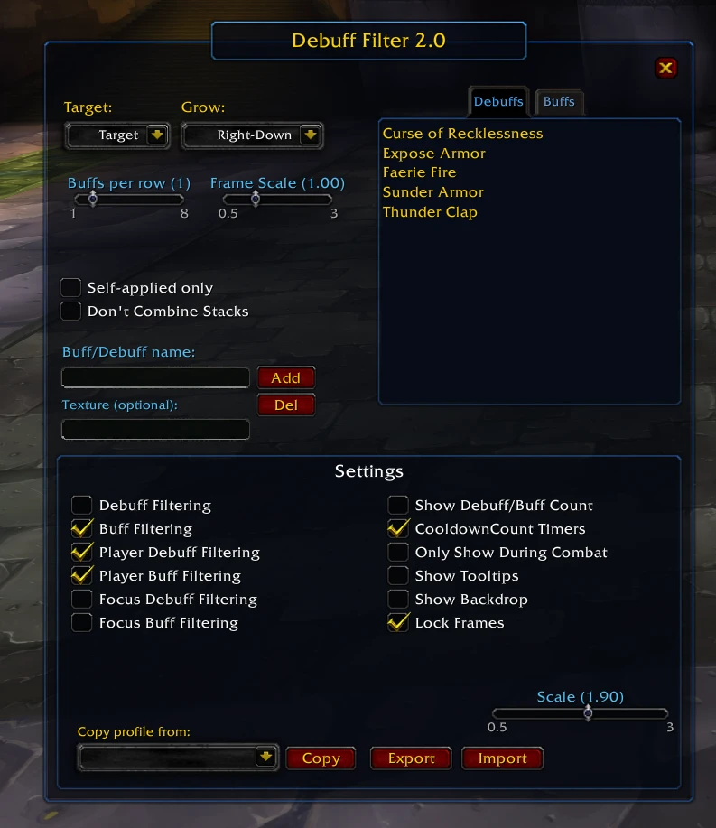

# Debuff Filter Enhanced

A World of Warcraft addon for WotLK 3.3.5a that lets you pull specific debuffs and buffs out of the default UI and display them in their own dedicated, movable frames — so you always see what actually matters.



---

## What it does

Instead of hunting through a crowded buff/debuff bar, Debuff Filter lets you hand-pick which auras to track and shows them in clean, configurable frames:

| Frame | Tracks |
|---|---|
| **Target Debuffs** | Debuffs on your current target |
| **Target Buffs** | Buffs on your current target |
| **Player Debuffs** | Debuffs on yourself |
| **Player Buffs** | Buffs on yourself |
| **Focus Debuffs** | Debuffs on your focus target |
| **Focus Buffs** | Buffs on your focus target |

Each frame is independent — you can enable only the ones you need.

---

## Installation

1. Download this repository (**Code → Download ZIP**) or clone it.
2. Rename the extracted folder to exactly **`DebuffFilter`** (GitHub names it `Debuff-filter-enhanced-main`; WoW will not load the addon unless the folder name matches the `.toc` file).
3. Copy the `DebuffFilter` folder into your addons directory:
   ```
   World of Warcraft/Interface/AddOns/
   ```
4. Launch the game and make sure **Debuff Filter Enhanced** is enabled in the AddOns list on the character select screen.

---

## Usage

All commands start with `/dfilter`:

| Command | Description |
|---|---|
| `/dfilter` | Open / close the configuration panel |
| `/dfilter config` | Same as above |
| `/dfilter allpd` | Toggle showing **all** player debuffs (not just the list) |
| `/dfilter allfd` | Toggle showing **all** focus debuffs |
| `/dfilter allfb` | Toggle showing **all** focus buffs |
| `/dfilter resetpos` | Reset all frame positions to their defaults |
| `/dfilter status` | Print current toggle states to chat |
| `/dfilter help` | Print the full command reference |

---

## Moving Frames

Turn on **Show Backdrop** in the panel to see where each frame is, then:

- **Shift + Left Click & Drag** — a backdrop or a tracked aura icon to reposition the frame.
- **Shift + Right Click** — cycle the frame's **grow direction** (Right-Down, Right-Up, Left-Down, Left-Up).
- **Ctrl + Right Click** — cycle the **timer position** around the icon.

Positions are saved per character and restored automatically on login. **Lock Frames** makes the icons click-through once you are happy with the layout.

---

## Configuration Panel

Open it with `/dfilter` and you'll find options to:

- **Enable/disable** each of the six frames
- **Add or remove** auras from any list (optionally only the ones you applied, or without combining stacks from different casters)
- Set **grow direction**, **icons per row** and **frame scale** for each frame
- Toggle the **aura count** badge and **cooldown spiral** timers
- Show frames **only in combat**
- Enable **tooltips** on hover
- **Lock** frames so clicks pass through them
- Adjust the **global scale**
- **Copy** your configuration from another character's profile
- **Export / Import** your settings as text, to move them to another account or share them

---

## Per-Character Profiles

Settings are stored per character under `DebuffFilter_Config`. You can copy a profile from any other character directly inside the options panel — handy when setting up an alt.

---

## Default Aura Lists

The addon ships with a starter list of commonly tracked auras (Sunder Armor, Faerie Fire, Anti-Magic Shell, Ice Block, and many more). The list is built from spell IDs, so the names come out in your client's language (English, Russian, German, Spanish…) and match the auras in game. You can freely add, remove, or replace any of them through the config panel.

The interface is translated into English, Spanish, Russian, German, French, Korean and Chinese.

---

## Requirements

- **Game version:** WotLK 3.3.5a (Interface `30300`)
- No external library dependencies

---

## Author

**Nidhaus** — v2.0
